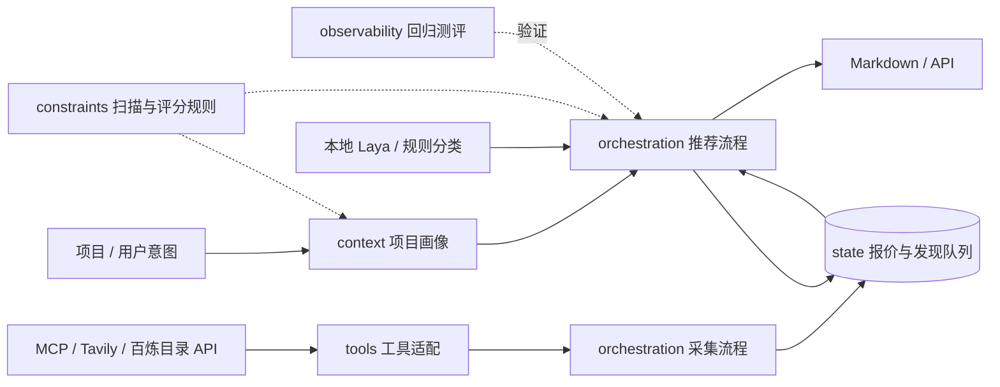

# 系统架构：六层职责

本项目按六项 Harness 职责组织 Python 包。参考 DeepSeek Harness 的能力拆分和可组合接口思路；六层命名是本项目的设计，并非其官方目录规范。当前保持标准库核心，不引入 Cordis 或大型插件运行时。

参考原始资料（2026-11-03 核对）：
- https://github.com/deepseek-ai/deepseek-harness
- https://github.com/deepseek-ai/deepseek-harness/blob/main/README.md
- https://github.com/deepseek-ai/deepseek-harness/tree/main/packages

## 实际目录和责任

```text
src/token_mentor/
├── context/                    # 1. 上下文工程
│   ├── analysis.py             # README / Markdown / 有界源码扫描、项目画像
│   └── task_intent.py          # 统一任务类别和规则回退分类
├── tools/                      # 2. 工具系统
│   ├── mcp.py                  # MCP 协议、远程工具调用、结构化结果解析
│   ├── aliyun_models.py        # 百炼工作空间模型目录 API
│   ├── tavily.py               # 官方网页/新闻搜索与提取
│   └── pricing.py              # 报价表解析、币种换算
├── orchestration/              # 3. 执行编排
│   ├── agents.py               # 研究、顾问和测评的调用入口
│   ├── collector.py            # 多数据源采集、失败隔离与入库流程
│   ├── decision.py             # 本地 Laya 意图分类和规则回退
│   ├── service.py              # 画像 → 缓存 → 排序 → 报告
│   ├── ranking.py              # 确定性排序计算
│   └── report.py               # 推荐理由、数据库建议、Markdown 组装
├── state/                      # 4. 状态与记忆
│   └── storage.py              # SQLite、报价快照、共享缓存、反馈、发现队列
├── observability/              # 5. 测评与可观测性
│   └── evaluation.py           # 人工维护的小型意图和排序回归集
├── constraints/                # 6. 约束与恢复策略
│   ├── scanning.py             # 扫描文件白名单、深度和总量上限
│   └── scoring.py              # 评分权重、配置校验
├── models.py                   # 跨层数据契约、字段校验
├── cli.py                      # CLI 适配和装配
└── api.py                      # HTTP 适配、认证和装配
```

根目录原来的 analysis / agents / collector / evaluation / ranking / report / service / storage 和 sources.mcp 是兼容导入入口，没有第二份业务实现。新代码必须导入六层内的正式模块。旧导入与新导入指向相同模块，保留原有调用和测试替身行为。

## 依赖边界

- constraints 只依赖标准库和跨层数据契约。
- context 可使用 constraints；不能调用外部工具、编排或数据库。
- tools 可使用 constraints；只负责工具交互，不能决定选型、调度或写业务数据库。
- state 可使用 constraints；不能调用工具、项目扫描或编排。
- orchestration 组合上述能力，负责业务顺序、缓存策略和结果处理。
- observability 可以调用 context 和确定性排序实现做回归，但不直接采集或写数据库。
- models 不导入六层模块；CLI/API 是应用装配入口。

这些是职责边界，不是强制逐层向下调用的栈。比如测评需要运行被测排序规则，编排层的 EvaluationAgent 则显式触发测评。tests/test_architecture.py 检查底层反向依赖和内部兼容入口使用。

## 数据流



搜索线索和报价快照是不同类型。发现队列中的名称、URL、摘要不直接进入价格排名；导入结构化报价仍需运营方核验原始来源。当前不会自动判定网页内容真实。

## 缓存与一致性

价格按 `(provider, model, source_url, observed_at)` 幂等 upsert。报告缓存键包括画像 fingerprint、任务、技术、token 数、评分权重、报价 fingerprint 和新鲜度窗口。变化会形成新键，旧报告按 TTL 过期。反馈关联报告 ID。

SQLite 使用 WAL、busy timeout 和逐次提交/关闭的连接。支持单机 API 和采集进程共享本地 volume；多机器共同写同一 SQLite 文件不属于当前支持范围。

## 当前完成和后续实现

已实现：有界项目分析、MCP/Tavily 适配、百炼目录 API 适配、任务分类器接口与规则回退、按目录能力标签筛选候选、正式报价确定性排序、共享缓存、反馈、离线测评，以及六层代码边界。百炼和 Laya 需要各自在本机/服务环境提供有效凭据或运行包才可实际请求/推理。

尚未实现：五节点持久状态机、benchmark 同版本证据对齐和运行耗时指标、订阅权益、客户模型配置自动更新。这些不能因为目录存在就称为完成。

后续落点：
- orchestration 增加 collect / quantify / analyze / recommend / assemble 节点和状态机。
- state 持久化 run、checkpoint、event 和固定输入快照；现已落地。
- constraints 持有扫描上限、评分阈值和工作流恢复次数策略；配置变更校验仍待实现。
- observability 增加节点事件、耗时、失败率和测评反馈；反馈不能直接覆盖线上规则。
- 客户自动更新先生成配置差异，再做校验、版本化应用与回滚；权益和调度属于业务编排。


## 账户、支付与次数账本

六层新增模块：`state/billing.py` 存账户、项目、Key 哈希、订单、次数流水和幂等请求；`tools/alipay.py` 封装官方 SDK 签名及网关交互；`orchestration/payments.py` 把验签/查询结果转换成充值事务；`orchestration/billing.py` 统一扣次、幂等执行与失败退款。`commerce_api.py` 是与 `api.py` 同级的 HTTP 适配层。

客户账户拥有项目，Key 可绑定账户或单个项目。价格和推荐缓存保持服务端私有，客户用量接口只提供自己的请求元数据。账户余额由 SQLite 立即事务保护，幂等请求同时持有 OS 锁，避免跨进程同时执行。成功支付同一事务更新订单、充值流水和账户余额，支付宝重复回调不重复入账。普通幂等响应正文有 24 小时 TTL，会话响应正文为 30 分钟；长期只保留计费元数据。

此实现适合单实例或共享同一持久目录的本机多进程部署；不承诺跨主机分布式锁或水平扩容能力。扩大部署时需替换为事务数据库与分布式任务执行机制。
